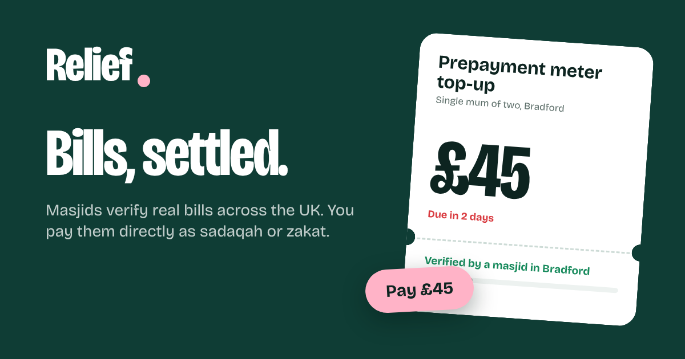

# Relief: bills, settled

**Live demo: https://sheedosa.github.io/relief-app/**

Relief is a concept for a UK Muslim giving app. Someone in hardship submits a real bill, a local masjid verifies it, and donors pay it directly to the biller as sadaqah or zakat, with Gift Aid.

> Demo only. All cases are sample data. No payments are taken and no Gift Aid is claimed.

## Why it works

| Problem | How Relief solves it |
|---|---|
| Donors can't tell if a need is real | Every bill is checked by a masjid committee, partner charity or university Islamic society |
| Cash handouts can be misused | Money goes straight to the energy supplier, council, landlord, school or funeral service |
| Asking for help is humiliating | Recipients are anonymous. Donors see the situation, never the name |
| Zakat has eligibility rules | Verifiers mark each bill as zakat-eligible or sadaqah only |
| Debt relief can involve riba | Only the principal is paid, never interest |
| UK donors leave money on the table | Gift Aid adds 25p per £1 for UK taxpayers |

## What's in the demo

- **Give**: swipe a bill right to pay or left to skip. Pay part or all, as sadaqah or zakat, with optional Gift Aid.
- **Request**: submit a bill for verification. Your name is never shown.
- **Zakat**: calculator with a silver or gold nisab, linked to zakat-eligible bills.
- **Impact**: your giving history and how Relief works.

Each tab has its own link, so you can share one directly:
[Give](https://sheedosa.github.io/relief-app/) ·
[Request](https://sheedosa.github.io/relief-app/#request) ·
[Zakat](https://sheedosa.github.io/relief-app/#zakat) ·
[Impact](https://sheedosa.github.io/relief-app/#impact)

## Files

| File | Purpose |
|---|---|
| `index.html` | The whole app: markup, styles and script, no build step |
| `og-image.png` | 1200×630 preview for WhatsApp, X, LinkedIn and iMessage |
| `favicon-32.png`, `icon-192.png`, `icon-512.png`, `apple-touch-icon.png` | Browser and home-screen icons |
| `manifest.webmanifest` | Lets people add Relief to their home screen |
| `robots.txt`, `sitemap.xml` | Search engine crawling |
| `404.html` | Sends broken links back to the app |
| `.nojekyll` | Serves files as they are, without Jekyll processing |

## Publishing on GitHub Pages

1. **Settings → Pages**
2. **Source**: Deploy from a branch. **Branch**: `main`, folder `/ (root)`. Save.
3. The site is live at `https://sheedosa.github.io/relief-app/` after a minute or two.

If you rename the repo or use a custom domain, update the URLs in `index.html` (canonical, Open Graph, Twitter and JSON-LD), `robots.txt`, `sitemap.xml` and `404.html`.

### After it's live

- Check the link preview with the [Facebook Sharing Debugger](https://developers.facebook.com/tools/debug/) and [LinkedIn Post Inspector](https://www.linkedin.com/post-inspector/).
- Add the site to [Google Search Console](https://search.google.com/search-console) and submit `sitemap.xml`.

## What a real version would need

- Registration with the Charity Commission, and HMRC recognition to claim Gift Aid
- Bill-pay integrations with UK energy suppliers, councils and water companies
- Verifier onboarding and an admin dashboard for masjids
- Sharia advisory review of the zakat rules and fee model
- Safeguarding, KYC and anti-fraud checks
- Arabic, Urdu and Bengali translations
